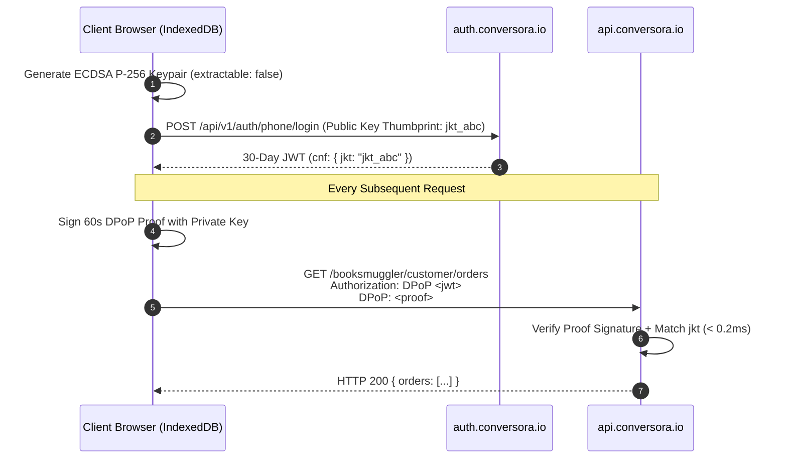

# `conversora-auth-sdk`

[](https://opensource.org/licenses/MIT)
[](https://workers.cloudflare.com)
[](https://www.rfc-editor.org/rfc/rfc9449)
[]()

> **Universal, zero-dependency, hardware-bound RFC 9449 DPoP authentication client with Clerk-grade developer ergonomics for Conversora headless e-commerce storefronts (Astro, Next.js, React, Remix, and Vanilla JS).**

---

## ⚡ Key Highlights

- 🔒 **Hardware-Bound Tokens (RFC 9449 DPoP)**: Generates non-exportable Web Crypto `ECDSA P-256` keypairs in IndexedDB. Tokens stolen via XSS or network capture are mathematically useless without the private key proof.
- ⚡ **Ultra-Low Latency (< 0.2ms)**: Pure stateless JWT verification on Cloudflare Workers edge nodes with **$0.00 database read cost**.
- 📱 **Bangladeshi Mobile Phone OTP Ready**: First-class support for `+880` mobile numbers, SMS OTP verification, and instant 1-click auto-registration.
- 📦 **Bangladeshi Logistics Address Book**: Built-in CRUD for `division`, `district`, `thana`, and default selectors ready for courier integration (Steadfast, Pathao, RedX).
- ⚛️ **Clerk-Style Drop-In React Components**: `<AuthProvider>`, `<SignedIn>`, `<SignedOut>`, `<UserButton>`, `useAuth()`, and `useUser()`.
- 🧪 **Offline Zero-DB Preview Mock Mode**: Pass `mockMode: true` to develop and preview complete customer portals offline with zero backend dependencies.
- 🔄 **4-Step Atomic Device Eviction**: Purges IndexedDB keys, scrubs local storage, invalidates cookies, and synchronizes across all open browser tabs via `BroadcastChannel`.

---

## 📦 1-Command Installation

No npm registry or tokens needed. Install directly via GitHub with a single command:

```bash
# Using pnpm (Recommended)
pnpm add github:conversora/conversora-auth-sdk

# Using npm
npm install github:conversora/conversora-auth-sdk

# Using yarn
yarn add github:conversora/conversora-auth-sdk

# Using bun
bun add github:conversora/conversora-auth-sdk
```

---

## 🚀 Quickstarts

### 1. Astro 4/5/7 Storefront (`src/pages/account.astro`)

```astro
---
// Server frontmatter
---
<div class="max-w-4xl mx-auto p-6">
  <div id="auth-loading">Loading patron profile...</div>

  <div id="auth-content" class="hidden">
    <h1 id="welcome-text" class="text-2xl font-bold"></h1>
    <button id="signout-btn" class="mt-4 px-4 py-2 bg-red-600 text-white rounded">
      Sign Out
    </button>
  </div>
</div>

<script>
  import { createAuthClient } from 'conversora-auth-sdk';

  const auth = createAuthClient({
    authUrl: 'https://auth.conversora.io',
    tenantId: 'booksmuggler', // Your store tenant slug
  });

  async function checkSession() {
    const session = await auth.getSession();
    if (!session) {
      window.location.href = await auth.getSignInUrl({ returnPath: '/account' });
      return;
    }

    const profile = await auth.account.getProfile();
    document.getElementById('auth-loading')!.classList.add('hidden');
    document.getElementById('auth-content')!.classList.remove('hidden');
    document.getElementById('welcome-text')!.innerText = `Hello, ${profile?.name || session.user.name}!`;

    document.getElementById('signout-btn')!.addEventListener('click', async () => {
      await auth.signOut({ redirectUrl: '/' });
    });
  }

  checkSession();
</script>
```

---

### 2. Next.js 14/15 App Router (`app/layout.tsx`)

```tsx
'use client';

import { AuthProvider } from 'conversora-auth-sdk/react';

export default function RootLayout({ children }: { children: React.ReactNode }) {
  return (
    <html lang="en">
      <body>
        <AuthProvider clientOptions={{ tenantId: 'booksmuggler' }}>
          {children}
        </AuthProvider>
      </body>
    </html>
  );
}
```

```tsx
// app/components/Header.tsx
'use client';

import {
  SignedIn,
  SignedOut,
  UserButton,
  useUser,
} from 'conversora-auth-sdk/react';

export function Header() {
  const { user } = useUser();

  return (
    <header className="flex justify-between items-center px-6 py-4 border-b">
      <div className="font-bold text-xl">Booksmuggler</div>

      <div>
        <SignedIn>
          <div className="flex items-center gap-4">
            <span className="text-sm text-gray-700">Hi, {user?.name}</span>
            <UserButton showName />
          </div>
        </SignedIn>

        <SignedOut>
          <a
            href="https://auth.conversora.io/signin?shop=booksmuggler"
            className="px-4 py-2 bg-black text-white text-sm rounded-md"
          >
            Sign In
          </a>
        </SignedOut>
      </div>
    </header>
  );
}
```

---

### 3. React SPA / Vite (`src/App.tsx`)

```tsx
import React from 'react';
import {
  AuthProvider,
  SignedIn,
  SignedOut,
  UserButton,
  useAuth,
  useUser,
} from 'conversora-auth-sdk/react';

export default function App() {
  return (
    <AuthProvider clientOptions={{ tenantId: 'booksmuggler' }}>
      <Dashboard />
    </AuthProvider>
  );
}

function Dashboard() {
  const { user, isLoaded } = useUser();
  const { fetchWithAuth } = useAuth();

  if (!isLoaded) return <p>Loading patron session...</p>;

  return (
    <div className="p-8">
      <SignedIn>
        <h2>Welcome back, {user?.name}!</h2>
        <UserButton />
        
        <button
          onClick={async () => {
            const res = await fetchWithAuth('https://api.conversora.io/booksmuggler/customer/orders');
            const data = await res.json();
            console.log('Customer orders:', data);
          }}
          className="mt-4 px-4 py-2 bg-blue-600 text-white rounded"
        >
          Load Orders (RFC 9449 DPoP)
        </button>
      </SignedIn>

      <SignedOut>
        <p>Please sign in to access your orders and saved books.</p>
        <a href="/signin" className="btn">Sign In</a>
      </SignedOut>
    </div>
  );
}
```

---

## 📱 Mobile Phone SMS OTP Authentication

```ts
import { createAuthClient } from 'conversora-auth-sdk';

const auth = createAuthClient({ tenantId: 'booksmuggler' });

// 1. Dispatch 6-digit SMS OTP to Bangladeshi number
const sendRes = await auth.phone.sendOtp({
  phone: '+8801700000000',
  turnstileToken: '0x4AAA...', // Cloudflare Turnstile token (optional)
});

// 2. Complete login or instant auto-registration
const loginRes = await auth.phone.login({
  phone: '+8801700000000',
  code: '849201',
});

if (loginRes.ok) {
  console.log('Access Token (DPoP):', loginRes.token);
  console.log('Patron Profile:', loginRes.user);
}
```

---

## 📦 Customer Address Book API (Bangladeshi Logistics)

Full support for division, district, thana, and default selectors matching Bangladesh courier integrations:

```ts
// 1. Fetch saved addresses
const addresses = await auth.account.listAddresses();

// 2. Add new address
const createRes = await auth.account.createAddress({
  recipientName: 'Solaman Shuvo',
  phoneNumber: '+8801700000000',
  division: 'Dhaka',
  district: 'Dhaka',
  thana: 'Dhanmondi',
  addressLine1: 'House 42, Road 9/A',
  addressLine2: 'Apartment 4B',
  postalCode: '1209',
  country: 'Bangladesh',
  isDefault: true,
});

// 3. Set address as default
await auth.account.setDefaultAddress(createRes.data!.id);

// 4. Update address
await auth.account.updateAddress(createRes.data!.id, {
  addressLine2: 'Apartment 5B (Updated)',
});

// 5. Delete address
await auth.account.deleteAddress(createRes.data!.id);
```

---

## 🛠️ Offline Zero-DB Preview Mock Mode

For frontend developers and AI agents cloning templates without active backend databases:

```ts
const auth = createAuthClient({
  mockMode: true,
  tenantId: 'booksmuggler',
});

// Immediately returns realistic mock data with zero network calls:
const profile = await auth.account.getProfile();
const addresses = await auth.account.listAddresses();
const config = await auth.store.getConfig();
```

---

## 📚 Complete API Reference

### Core Methods (`auth.*`)

| Method | Parameters | Return Type | Description |
| :--- | :--- | :--- | :--- |
| `getSession()` | - | `Promise<AuthSession \| null>` | Returns active DPoP session from memory / IndexedDB. |
| `getUser()` | - | `Promise<User \| null>` | Returns current customer user profile. |
| `getSignInUrl(opts)` | `{ storeName?, returnPath? }` | `Promise<string>` | Generates hosted sign-in URL with device `dpop_jkt`. |
| `fetch(url, init)` | `url: string, init?: RequestInit` | `Promise<Response>` | Fetch with automatic RFC 9449 DPoP proof attachment and 401 auto-logout. |
| `signOut(opts)` | `{ redirectUrl?, broadcast? }` | `Promise<void>` | Executes 4-step atomic hardware key and session wipe. |
| `onAuthStateChange(cb)`| `(user, session) => void` | `() => void` | Subscribes to real-time auth state updates. |

### Phone Subsystem (`auth.phone.*`)

| Method | Parameters | Description |
| :--- | :--- | :--- |
| `sendOtp(opts)` | `{ phone, turnstileToken? }` | Dispatches SMS verification code. |
| `verify(opts)` | `{ phone?, code, turnstileToken? }` | Verifies code validity. |
| `login(opts)` | `{ phone, code, turnstileToken? }` | Verifies code, auto-registers if new, and mints 30-day session. |

### Account Subsystem (`auth.account.*`)

| Method | Parameters | Description |
| :--- | :--- | :--- |
| `getProfile()` | - | Fetches customer profile (name, email, phone, tier, points). |
| `updateProfile(data)` | `{ name?, email?, phone?, avatarUrl? }` | Updates profile particulars. |
| `listAddresses()` | - | Lists customer saved delivery addresses. |
| `createAddress(data)` | `CreateAddressInput` | Adds a new delivery location. |
| `updateAddress(id, data)` | `id: string, UpdateAddressInput` | Updates an existing address. |
| `deleteAddress(id)` | `id: string` | Deletes an address. |
| `setDefaultAddress(id)` | `id: string` | Sets address as default for checkout. |
| `changePassword(old, new)` | `currentPassword, newPassword` | Changes account password. |

### Store Subsystem (`auth.store.*`)

| Method | Parameters | Description |
| :--- | :--- | :--- |
| `getConfig(slug?)` | `storeSlug?: string` | Discovers active merchant auth switches (phone OTP, email, social). |

---

## 🔒 Security Architecture (RFC 9449 DPoP)

Unlike legacy JWTs where intercepted strings grant full access, Conversora access tokens are cryptographically locked to a client-side non-extractable key:



---

## 📄 License

MIT © [Conversora Inc.](https://conversora.io)
